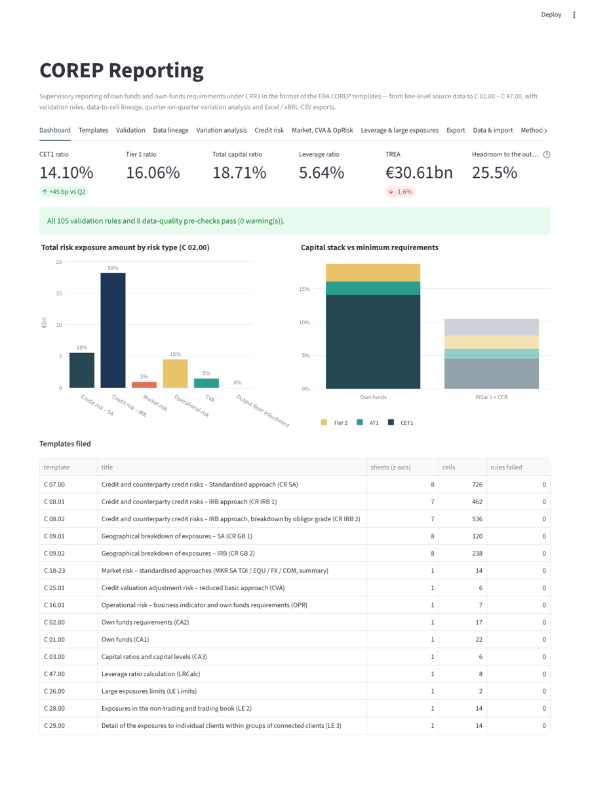
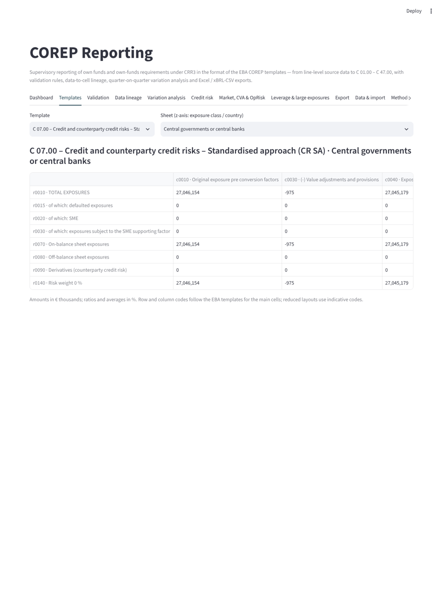
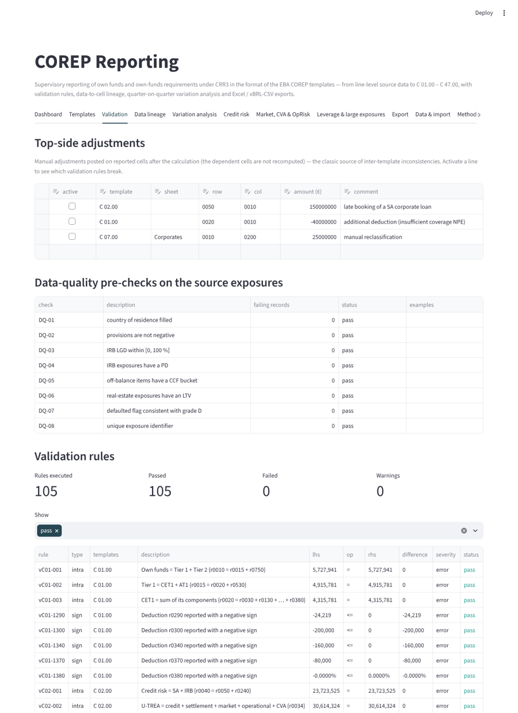
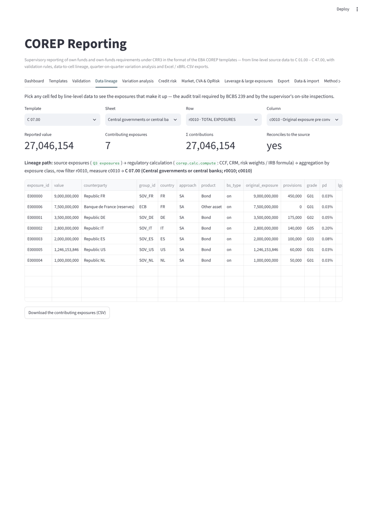
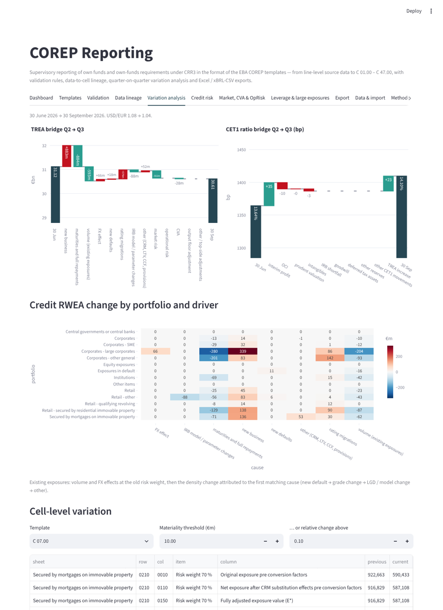
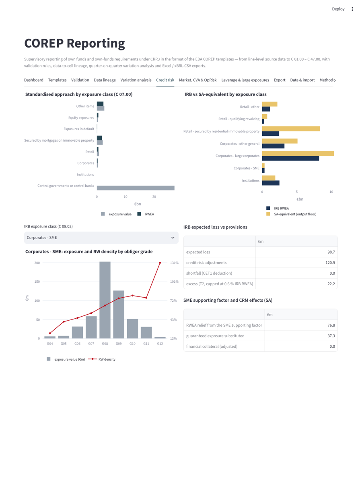
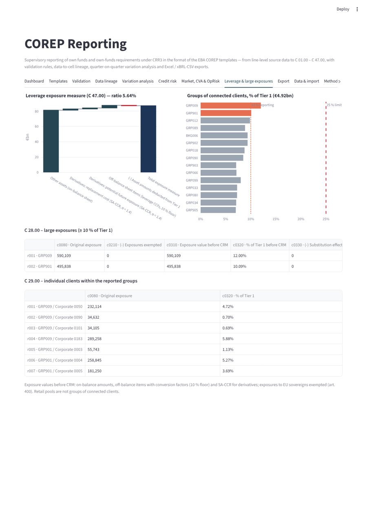

# COREP Reporting

A Python and Streamlit engine for supervisory reporting under **CRR3**. It turns line-level source data into **EBA COREP templates** at two reference dates (30 June and 30 September 2026). The templates cover:

- own funds and ratios;
- credit risk under SA and IRB, with geographical breakdowns;
- market risk, CVA and operational risk;
- the leverage ratio;
- large exposures.

On top of the templates, the engine provides:

- data-quality pre-checks;
- EBA-style validation rules;
- data → cell lineage;
- quarter-on-quarter variation analysis;
- Excel and xBRL-CSV-style exports.



## Regulatory context (October 2026)

- **CRR3** (Regulation (EU) 2024/1623) has applied since 1 January 2025. The first COREP reference date under CRR3 was 31 March 2025, under EBA reporting framework 4.0. CRR3 changed several templates:
  - output floor information in C 02.00 to C 04.00;
  - new SA risk-weight granularity in C 07.00 and C 09.01;
  - new IRB exposure classes in C 08;
  - the new operational-risk template C 16.01;
  - new leverage rows.
- **Framework 4.2** moved all reports to DPM 2.0. From the **March 2026 reference date**, submissions must be in **xBRL-CSV**; xBRL-XML is no longer accepted.
- **Release 4.4** (October 2026) covers IFRS 18 FINREP and Pillar 3 changes. The reporting simplification package (4.4.1) is expected in early 2027.
- **FRTB**: in the EU, the own-funds requirements are postponed. A delegated act adopted on 4 June 2026 sets application from 1 January 2027, subject to scrutiny. For 2026 reference dates, market risk therefore uses the CRR2 standardised approaches (C 18 – C 24).
- **Output floor**: 55 % in 2026 (art. 465), with the 125 % cap on the floored TREA during the transition.

## Templates produced

| Template | Content |
|---|---|
| C 01.00 | Own funds: CET1 components and deductions (AVA, goodwill, intangibles, DTA, IRB shortfall), AT1, T2 (incl. IRB excess) |
| C 02.00 | Risk exposure amounts by risk type, U-TREA, S-TREA and the output-floor adjustment |
| C 03.00 | CET1, T1 and total capital ratios, on floored and un-floored TREA |
| C 07.00 | SA by exposure class (z-axis). Columns: original exposure, provisions, CRM outflows/inflows, financial collateral, E*, exposure value, RWEA pre/post SME supporting factor. Rows: on-balance, off-balance, derivatives, risk-weight buckets |
| C 08.01 / C 08.02 | IRB by exposure class and by obligor grade: PD, exposure value, LGD, maturity, RWEA, EL, provisions, number of obligors |
| C 09.01 / C 09.02 | Geographical breakdown (country of residence) for SA and IRB |
| C 16.01 | Operational risk: business indicator (ILDC, SC, FC) and BIC |
| C 18-23 | Market risk, standardised (debt general and specific, equity, FX, commodities) |
| C 25.01 | CVA risk, reduced basic approach |
| C 47.00 | Leverage ratio exposure measure |
| C 26.00 / C 28.00 / C 29.00 | Large-exposure limits, groups of connected clients ≥ 10 % of Tier 1, individual clients |

Row and column codes follow the EBA templates for the main cells. Where CRR3 layouts contain many detailed rows (risk-weight buckets, new sub-classes), the app keeps a reduced set with **indicative** codes.

## Calculation chain

1. **Source data**: line-level exposures (about 2,900 per date), trading positions, own-funds items, and the P&L for the business indicator.
2. **Data-quality pre-checks** (DQ-01 … DQ-08): completeness and plausibility of the fields used. Source defects can be injected on demand.
3. **Regulatory calculation**:
   - CCFs;
   - CRM: financial collateral comprehensive method, substitution for guarantees;
   - CRR3 SA risk weights: real-estate loan splitting, IPRE, defaulted assets, 2026 equity transitional weight;
   - SME supporting factor;
   - IRB formula with CRR3 input floors and F-IRB supervisory LGDs;
   - EL versus provisions;
   - SA-equivalent RWEA for the output floor;
   - SA market risk;
   - reduced BA-CVA;
   - business-indicator component;
   - leverage exposure;
   - large exposures.
4. **Templates**: aggregation into COREP cells. Every cell fed by line-level data keeps its exposure-level contributions.
5. **Validation**: 105 intra-template, inter-template, sign, range, completeness and limit rules (internal IDs vC…). Examples:
   - C 01.00 r0010 = r0015 + r0750;
   - C 02.00 r0050 = Σ C 07.00 {r0010; c0220};
   - C 03.00 = C 01.00 / C 02.00;
   - C 08.01 = Σ C 08.02;
   - Σ C 09.01 = Σ C 07.00;
   - C 47.00 Tier 1 = C 01.00 r0015;
   - CRM outflows = inflows;
   - no exposure without a country.

   **Top-side adjustments** can be activated to show which rules break.
6. **Variation analysis**:
   - TREA bridge, with credit RWEA split into new business, maturities, volume, FX, new defaults, rating migrations, IRB model/parameter changes and other;
   - CET1 ratio bridge;
   - portfolio × driver heat map;
   - cell-level variations above materiality thresholds.
7. **Exports**:
   - Excel workbook, one sheet per template and z-axis value;
   - xBRL-CSV-style report package (reportPackage.json, report.json, parameters.csv, FilingIndicators.csv, one CSV per table). Datapoints are named by template/row/column codes rather than official DPM IDs, so the package is **not submittable**.

| | |
|---|---|
|  |  |
|  |  |
|  |  |

## Synthetic bank

A mid-sized EU bank with about €85bn of exposures, a 14 % CET1 ratio and a 5.6 % leverage ratio. Its credit book is:

- sovereigns and central bank reserves (SA);
- institutions (F-IRB);
- large and mid corporates (IRB);
- SMEs (half SA under permanent partial use, half IRB);
- income-producing commercial real estate (SA);
- residential mortgages, credit cards and consumer loans (IRB);
- an SA retail subsidiary;
- equities and other assets.

Q3 is derived from Q2 with the movements a reporting team must explain:

- new business and maturities;
- repayments;
- rating migrations, including a downgrade cluster in commercial real estate;
- new defaults;
- the USD/EUR move from 1.08 to 1.04;
- an LGD re-calibration of the consumer-loan model;
- an interim profit.

## Run

```bash
pip install -r requirements.txt
streamlit run app.py
```

Tests:

```bash
pip install -r requirements-dev.txt
pytest -q
```

The tests cover:

- all rules passing on clean data;
- IRB reference risk weights;
- SA risk weights (loan splitting, SME, defaulted);
- ratio identities;
- the output floor and its 125 % cap when forced;
- top-side adjustments breaking the expected rules;
- injected defects being caught;
- lineage reconciliation;
- bridges adding up;
- the Excel and xBRL-CSV packages;
- CSV import validation;
- an app smoke test.

## Project layout

```
corep/
  data.py         synthetic bank at two reference dates, defect injection, import validation
  calc.py         CCF, CRM, SA and IRB risk weights, EL, SME factor, market risk SA, BA-CVA, business indicator, leverage, large exposures
  templates.py    COREP cells (C 01 – C 47) and exposure-level contributions, top-side adjustments
  validation.py   validation rules and data-quality pre-checks
  variation.py    cell variations, RWEA / TREA / CET1-ratio bridges
  export.py       Excel workbook and xBRL-CSV-style package
app.py            Streamlit app
tests/            pytest suite
```

## Limits

Reduced template layouts and indicative codes are used for detailed rows. The following are not covered:

- securitisations;
- CIU look-through;
- NPE insufficient-coverage deduction;
- significant investments and threshold deductions;
- SFTs;
- IFRS 9 transitional arrangements.

Prudent valuation uses the simplified approach. This is an educational and demonstration tool, not a production reporting system.

## License

MIT
